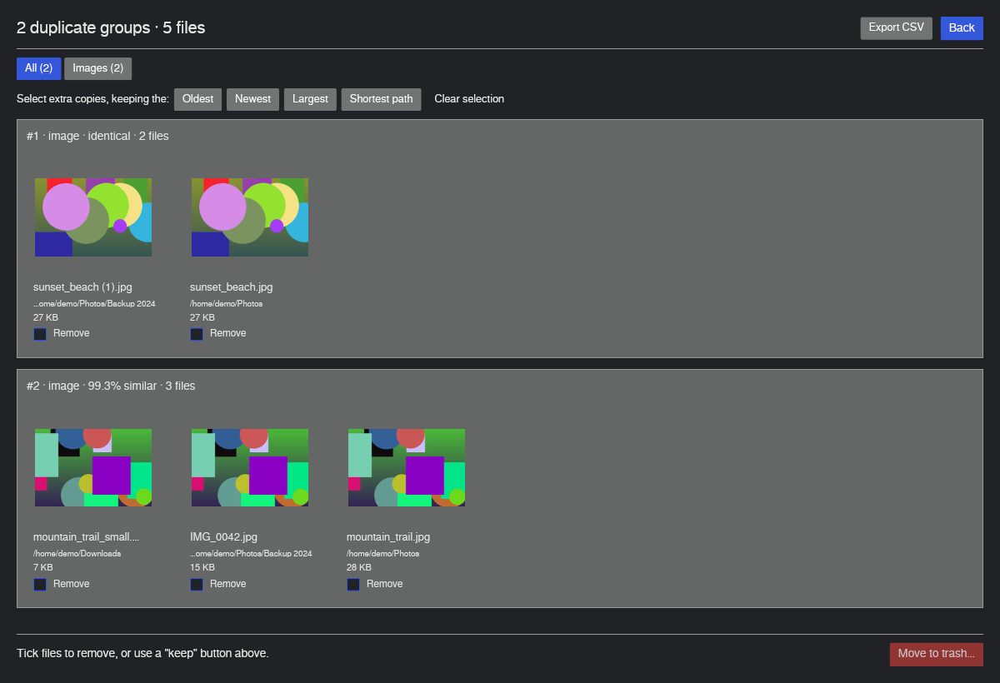
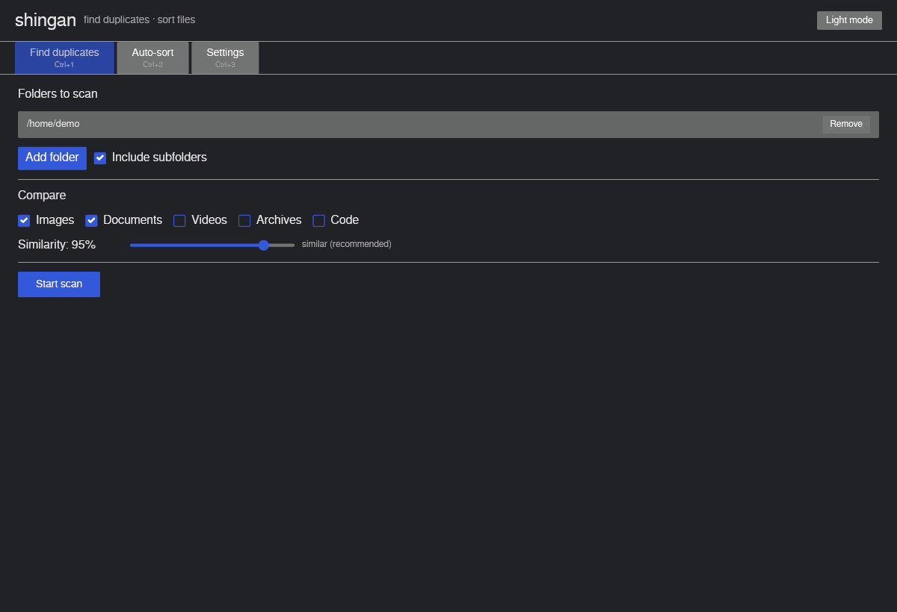

<p align="center">
  
</p>

<h1 align="center">shingan</h1>

<p align="center">
  <strong>Find duplicate files, even when they aren't exact copies, and tidy up messy folders.</strong><br>
  <em>shingan (心眼): "the mind's eye", seeing what lies beneath the surface.</em>
</p>

<p align="center">
  <a href="#install">Install</a> ·
  <a href="#quick-start">Quick start</a> ·
  <a href="#what-it-can-find">What it finds</a> ·
  <a href="#sorting-folders">Sorting</a> ·
  <a href="#faq--troubleshooting">FAQ</a> ·
  <a href="docs/how-it-works.md">How it works</a>
</p>

---

Most duplicate finders only catch byte-for-byte copies. shingan also finds the
**resized photo**, the **re-saved JPEG**, the **re-encoded video**, the
**document with one sentence changed**, and the **script that was only reformatted**.
Everything runs on your own computer. Nothing is uploaded unless you turn on
the optional cloud classification.

It comes as a **desktop app** and a **command-line tool**, for Windows, macOS
(Apple Silicon) and Linux.

<p align="center">
  
</p>

## Highlights

- **Near-duplicate detection** for images, videos, documents (PDF, Word, ODT, text, subtitles) and source code, plus exact matching for archives.
- **Safe cleanup.** Removed files go to the **trash / recycle bin** by default, at least one copy of every group is **always kept**, and you confirm before anything happens.
- **Auto-sort.** Moves files into `images/`, `documents/`, `videos/`, ... with a **preview mode** and **one-click undo**.
- **Optional local AI** to sort images into folders like `photo_landscape`, `screenshot_desktop`, `meme` or `diagram`. Runs offline.
- **Fast re-scans.** Fingerprints are cached, so unchanged files are skipped next time.
- **Scan history.** Reopen earlier results, export them to CSV or JSON.

## Install

Download the latest build for your system from the
[**Releases page**](https://github.com/rc-basilisk/shingan/releases/latest):

| System | Desktop app | Command line |
|---|---|---|
| Windows (x64) | `shingan-gui-x86_64-pc-windows-msvc.zip` | `shingan-cli-x86_64-pc-windows-msvc.zip` |
| macOS (Apple Silicon) | `shingan-gui-aarch64-apple-darwin.tar.xz` | `shingan-cli-aarch64-apple-darwin.tar.xz` |
| Linux (x64) | `shingan-gui-x86_64-unknown-linux-gnu.tar.xz` | `shingan-cli-x86_64-unknown-linux-gnu.tar.xz` |

Unpack it and run `shingan-gui` (or `shingan` from a terminal). There is
nothing else to install for images, documents, code and archives.

<details>
<summary>One-line installers (put the program on your PATH)</summary>

```sh
# macOS / Linux
curl --proto '=https' --tlsv1.2 -LsSf https://github.com/rc-basilisk/shingan/releases/latest/download/shingan-gui-installer.sh | sh
curl --proto '=https' --tlsv1.2 -LsSf https://github.com/rc-basilisk/shingan/releases/latest/download/shingan-cli-installer.sh | sh
```

```powershell
# Windows (PowerShell)
powershell -ExecutionPolicy Bypass -c "irm https://github.com/rc-basilisk/shingan/releases/latest/download/shingan-gui-installer.ps1 | iex"
powershell -ExecutionPolicy Bypass -c "irm https://github.com/rc-basilisk/shingan/releases/latest/download/shingan-cli-installer.ps1 | iex"
```
</details>

### Optional extras

| For | Install | Why |
|---|---|---|
| Comparing **videos** | [FFmpeg](https://ffmpeg.org/download.html) (`ffmpeg` and `ffprobe` on your PATH) | shingan uses it to read video frames |
| PDF page previews in the app | Poppler (`pdftoppm`) | Without it, PDFs are previewed as text |
| Sorting images into sub-folders | Nothing. Click **Download** in *Settings*, or run `shingan model download` | Fetches the ~340 MB image model plus ONNX Runtime |

Windows: `winget install ffmpeg` · macOS: `brew install ffmpeg poppler` ·
Debian/Ubuntu: `sudo apt install ffmpeg poppler-utils`

Run `shingan doctor` at any time to see which of these are available.

## Quick start

### Desktop app

1. **Find duplicates** tab: *Add folder*, tick the file types to compare, then **Start scan**.
   (You can also start it as `shingan-gui ~/Pictures` to pre-fill a folder.)
2. Results open automatically. Click a thumbnail to preview it, or click a folder name to show the file in your file manager.
3. Pick what to keep with **Oldest / Newest / Largest / Shortest path**, or tick files by hand.
4. Press **Move to trash…** and confirm. At least one copy of each group always stays.

<p align="center">
  
</p>

Keyboard shortcuts: <kbd>Ctrl</kbd>+<kbd>1</kbd>/<kbd>2</kbd>/<kbd>3</kbd>
switch tabs, <kbd>Ctrl</kbd>+<kbd>Enter</kbd> starts a scan,
<kbd>Ctrl</kbd>+<kbd>T</kbd> toggles light/dark, <kbd>Esc</kbd> closes a
preview or the results (<kbd>⌘</kbd> instead of <kbd>Ctrl</kbd> on macOS).

### Command line

```sh
shingan scan ~/Pictures                    # images + documents (the default)
shingan scan ~/Downloads -t all -T 0.9     # every file type, 90% similarity
shingan list                               # past scans
shingan list 3                             # groups found by scan #3
shingan delete 3 --keep oldest --dry-run   # preview the cleanup
shingan delete 3 --keep oldest             # move extra copies to the trash (asks first)
shingan export 3 -o dupes.json             # CSV or JSON, picked from the extension
```

`-t` takes `image`, `document`, `video`, `archive`, `code` or `all`,
comma-separated. `--keep` takes `oldest`, `newest`, `largest` or
`shortest-path`. Add `--permanent` to `delete` to skip the trash.
Run `shingan help <command>` for every option.

## What it can find

| Type | Extensions | Counts as a duplicate when |
|---|---|---|
| Images | jpg, jpeg, png, gif, bmp, webp, tiff | they look the same, even resized, recompressed or converted |
| Videos | mp4, mkv, mov, avi, webm, wmv, flv, m4v | the footage matches, even re-encoded or at another resolution |
| Documents | pdf, docx, doc, odt, rtf, txt, srt, vtt, sub | the text is (nearly) the same, regardless of formatting |
| Code | py, js, ts, jsx, tsx, rs, go, c, cpp, h, html, css, vue, exs | the code matches after ignoring comments and whitespace |
| Archives | zip, tar, gz, bz2, xz, 7z, rar, zst | byte-for-byte identical |

**The similarity slider** (default 95%) controls how alike files must be.
100% finds only identical content. 90-95% catches resized or re-saved copies
and lightly edited documents. Below about 85% you'll start seeing files that
are merely similar, so review before deleting.

Limits worth knowing: heavily **cropped** or rotated images aren't matched,
scanned PDFs without a text layer can't be compared by content, and files
smaller than 1 KiB are skipped (configurable).

## Sorting folders

**Auto-sort** moves files into one folder per type: `images/`, `documents/`,
`videos/`, `archives/`, `code/`, and `others/` for everything else.

- **Preview only** is on by default: you see every planned move before anything happens.
- Hidden files and tool folders (`.git`, `node_modules`, ...) are never touched, and the destination may live inside the folder being sorted.
- Every real sort can be **undone**: click *Undo this sort*, or run `shingan undo-sort <destination>`.
- Name clashes become `name_1.jpg`, `name_2.jpg`, ..., so nothing is overwritten.

```sh
shingan sort ~/Downloads -d ~/Sorted --dry-run     # preview
shingan sort ~/Downloads -d ~/Sorted --classify    # also sort images into sub-folders
shingan undo-sort ~/Sorted                         # put everything back
```

### Image sub-folders (optional AI)

With **Sort images into sub-folders** (or `--classify`), images are filed into
one of 24 categories:

| Group | Folders |
|---|---|
| Photos | `photo_landscape`, `photo_portrait`, `photo_food`, `photo_animal`, `photo_architecture`, `photo_event`, `photo_product`, `photo_general` |
| Screens | `screenshot_desktop`, `screenshot_mobile`, `screen_recording_frame` |
| Art | `artwork`, `anime_manga`, `pixel_art`, `comic`, `render_3d` |
| Info | `diagram`, `infographic_chart`, `scanned_document`, `handwritten` |
| Other | `meme`, `ui_design`, `logo_icon`, `other` |

This uses a CLIP image model that runs **offline on your computer**. Download
it once from *Settings → Image sub-categories → Download*, or run
`shingan model download`. Without it, only simple rules apply (screenshots by
resolution, icons by size, camera photos by EXIF), and most images land in `other`.

Images the model isn't sure about go to `images/other`. Raise or lower
*Minimum confidence* in Settings to make that stricter or looser.

**Cloud classification** (off by default) can ask a vision model about the
images the local model is unsure of: [Ollama](https://ollama.com) running on
your machine, or OpenAI, Google Gemini or Anthropic Claude with your own API
key. Images are shrunk to 768 px before sending. You can cap the number of
requests per sort. API keys can be stored in Settings or read from
`OPENAI_API_KEY`, `GEMINI_API_KEY` or `ANTHROPIC_API_KEY`.

## FAQ & troubleshooting

**Is it safe?** Removal goes to the trash by default, at least one copy per
group is always kept, files that vanished since the scan are skipped, and both
the app and `shingan delete` ask before acting. Sorting has a preview mode and
an undo journal. Still: you're deleting files, so review the groups first.

**"Videos" finds nothing / video files are skipped.** Install FFmpeg so that
`ffmpeg` and `ffprobe` work in a terminal, then rescan. `shingan doctor` checks this.

**Image sub-folders don't work.** Run `shingan doctor`. Both *CLIP model* and
*ONNX Runtime* should say `ok`. Downloading the model also downloads ONNX
Runtime. If you already have ONNX Runtime 1.18 or newer installed elsewhere,
point `ORT_DYLIB_PATH` at its library file.

**macOS says the app "can't be opened".** The builds aren't signed. Right-click
the program and choose *Open*, or run
`xattr -d com.apple.quarantine shingan-gui` once.

**Windows SmartScreen warns about the download.** Choose *More info → Run
anyway*. The builds aren't signed.

**Linux: the app doesn't start.** It needs a desktop session with the usual
X11/Wayland libraries (`libxkbcommon-x11`, `libwayland`, OpenGL/Vulkan
drivers), which all mainstream desktops ship.

**Where is my data?** Run `shingan doctor` to print the exact paths.

| What | Linux | macOS | Windows |
|---|---|---|---|
| Scan history and fingerprint cache | `~/.local/share/shingan/shingan.db` | `~/Library/Application Support/shingan/shingan.db` | `%LOCALAPPDATA%\shingan\shingan.db` |
| Image model | `~/.local/share/shingan/models/` | `~/Library/Application Support/shingan/models/` | `%LOCALAPPDATA%\shingan\models\` |
| Settings | `~/.config/shingan/settings.json` | `~/Library/Application Support/shingan/settings.json` | `%APPDATA%\shingan\settings.json` |
| Thumbnails | `~/.cache/shingan/` | `~/Library/Caches/shingan/` | `%LOCALAPPDATA%\shingan\` |

Deleting these folders resets shingan completely.

## Building from source

You need [Rust](https://rustup.rs) 1.88 or newer. On Linux, also install the
GUI build dependencies (Debian/Ubuntu:
`sudo apt install pkg-config libxkbcommon-dev libwayland-dev libgl-dev libegl-dev libdbus-1-dev`).

```sh
git clone https://github.com/rc-basilisk/shingan.git
cd shingan
cargo build --release            # binaries end up in target/release/
cargo run --release -p shingan-gui
```

See [docs/development.md](docs/development.md) for the project layout, tests
and the release process, and [docs/how-it-works.md](docs/how-it-works.md) for
the detection algorithms and the image-classification pipeline.

## License

Released into the public domain under [CC0 1.0 Universal](LICENSE).
